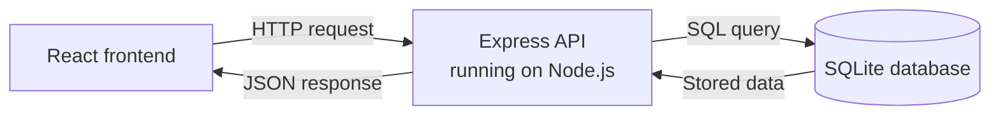
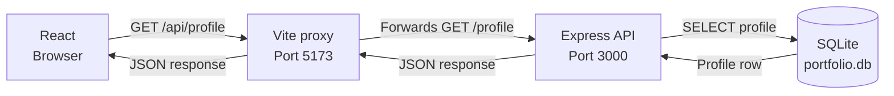

# Portfolio Architecture

This diagram shows how the three main parts of the portfolio will communicate.

## Development Request Flow with the Vite Proxy

During development, React sends API requests to Vite. The Vite proxy forwards them to Express, which reads the profile from SQLite and returns JSON through the same path.

Open this file in VS Code and press `Cmd+Shift+V` to see the rendered diagram.
